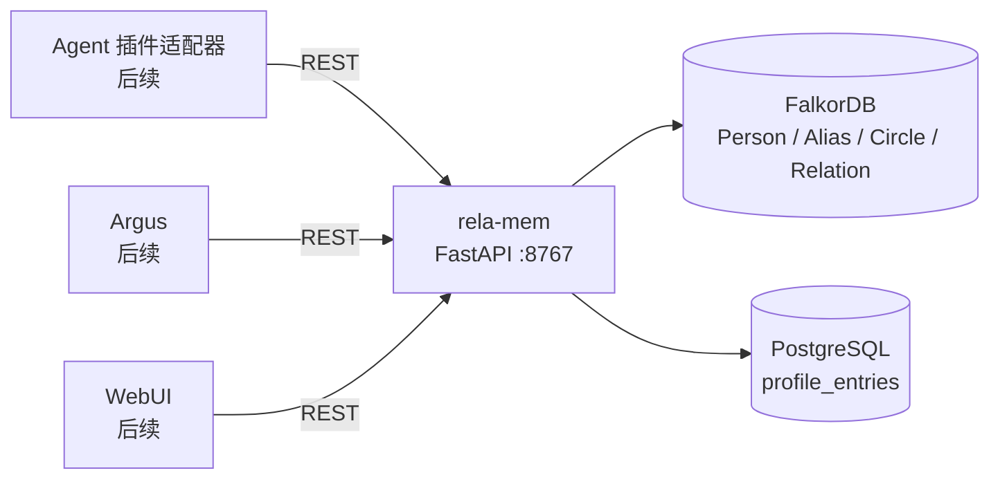

# rela-mem 基座服务设计

| 项目 | 内容 |
|---|---|
| 文档版本 | v1.0 |
| 日期 | 2026-10-18 |
| 状态 | 后端已实现并通过隔离验证；当前源码架构见 arch.md |
| 范围 | 独立基座服务：REST API + FalkorDB + PostgreSQL |
| 后续消费者 | Agent 插件适配器、Argus、WebUI |
| 取代 | `D:\Projects\Icarus-docs\technical-design.md` v0.1 中与本文件冲突的部分 |

> 本文保留已确认的目标设计；当前源码、测试与实际实现边界以 [arch.md](arch.md) 为准。实施和验证记录在 [plan.md](plan.md)。

## 1. 定位与边界

`rela-mem` 是与 `argus`、`mem0`、`openkb` 平级的**独立基座服务**，不是 Agent 内部插件，也不是 Argus 的子模块。

它拥有并维护：

- 人物身份：Person、Alias；
- 圈子与成员：Circle、Membership；
- 人物关系：Relation；
- 人物档案事实：Profile Entry。

它不负责：

| 数据/职责 | 归属 |
|---|---|
| 发生过什么（事件、经历、对话叙事） | mem0 |
| 原始聊天观察流、唤醒/沉默判断 | Argus |
| 知识文档、Wiki、文档实体 | openkb |
| Agent 执行状态、会话、任务 | Gateway / Agent |
| 分类“这是事件还是档案” | 消费方（Agent 插件/用户/导入流程） |
| 主动观察、主动推送 | Argus |

### 1.1 事件与档案的语义边界

- **事件**：有时间点、发生过一次、属于经历。例子：“我上周去摄影了”“姐姐今天说猫罐头从 50 降到 10”。写 mem0。
- **档案**：稳定属性、偏好、身份、关系。例子：“我喜欢摄影”“姐姐的猫喜欢猫罐头”。写 rela-mem。
- 同一段对话可能同时产生事件和档案。**分类由消费方决定**；rela-mem 不做理解、不做 LLM 抽取，只提供强类型写入接口。
- 档案条目通过可选的 `source_ref` 指回产生它的 mem0 memory id、Argus observation id 或导入批次，保证可追溯但不耦合。

### 1.2 消费者与实施顺序

1. **后端服务**（本期）：完整 REST 服务、存储、初始化、测试、种子。没有消费者接入。
2. **Agent 插件适配器**（后续）：把部分接口包装成 Tool，并把“事件/档案”分类规则写进提示词或工具 schema。
3. **Argus 接入**（后续）：用 `identity.resolve`、`GET /relations`、`GET /circles/{id}/members` 组装社会上下文。
4. **WebUI**（更后续）：浏览与人工修正。

本期不改 Agent、Gateway、Argus 的代码，也不扩展根 `icarus install/start/stop/status` 控制面或无参数全栈启动列表；安装、运行和测试先通过应用自己的脚本、Compose 及 `make test-rela-mem` 完成。统一生命周期和其他服务迁移不作为本期功能前提。

## 2. 总体架构

### 2.1 代码依赖与职责

应用使用 Python 3.12、FastAPI 和异步数据库客户端；`src` 直接为 import root，不再套应用包名。请求沿 `api → domain/services → repositories → 数据库` 调用；底层不反向依赖 HTTP 接口。

| 部分 | 职责 | 不负责 |
|---|---|---|
| `main.py` | 应用工厂、连接池生命周期、依赖组装、注册路由与异常处理 | 业务判断、SQL/Cypher |
| `api/` | Bearer 认证、解析参数、调用服务、HTTP 状态与响应 | 直接读写数据库 |
| `schemas/` | Pydantic 请求/响应校验和 OpenAPI 契约 | 维护独立的业务事实副本 |
| `domain/models.py`、`enums.py` | 层间复用的业务类型、状态和方向枚举 | 数据库客户端、FastAPI 对象 |
| `domain/services/` | 身份解析、关系方向规则、归档规则、档案追加/删除规则 | HTTP、连接池、具体 SQL/Cypher |
| `repositories/` | 参数化 SQL/Cypher、结果映射、单库原子写入 | 判定事件/档案分类、跨库写入编排 |
| `config.py` | 严格加载部署配置和 Secret 引用 | 推理、读取其他应用内部配置 |
| `scripts/` | 安装、测试、初始化、种子与隔离冒烟入口，复用应用逻辑 | 再实现一套业务规则 |

只为已有测试替身需求定义窄仓储接口，不增加通用 CRUD 基类、通用 Repository 框架、事件总线、插件系统或后台推理流程。同步工具脚本通过同一异步应用接口运行，不另做一套同步业务实现。

源码以 `src` 为 import root，不再套一层 `rela_mem` 包：启动使用 `uvicorn main:app --app-dir src`，业务模块直接 `from api...`、`from domain...`、`from config import ...`。测试镜像源码层级：`src/api/...` 对应 `test/api/...`，`src/domain/services/...` 对应 `test/domain/services/...`。HTTP 契约测试覆盖认证/校验/响应，真实数据库集成测试覆盖查询、约束、并发和故障。

### 2.2 部署依赖



技术栈：

| 层 | 选择 |
|---|---|
| HTTP | FastAPI + Pydantic v2 |
| 协议 | REST/JSON，统一 `/v1` 前缀 |
| 图存储 | FalkorDB 4.22.1，官方异步客户端 |
| 档案存储 | PostgreSQL 17 + SQLAlchemy 2.0 async + asyncpg |
| 初始化 | `scripts/init_graph.py`、`scripts/init_postgres.py`（幂等，不做迁移框架） |
| 测试 | pytest + httpx/TestClient；集成测试使用真实 FalkorDB + PostgreSQL |
| 部署 | Docker Compose：`rela-mem` + `falkordb` + `postgres`；本地镜像优先，暂不 push |

### 2.3 审查已消除的实现歧义

以下是保持已确认功能不变的实现约束，不新增业务字段、表或产品能力：

- 档案先选每个 key 最新一行，再过滤 `status` 和关键词；不能先过滤 `active`，否则删除后会重新显示旧值。`null` 是合法 JSON 值；删除使用 `status=deleted` 区分，写入 SQL JSONB 时墓碑值为 JSON `null`，不是违反 `NOT NULL` 的 SQL NULL。
- 双向关系的幂等键不依赖传入的端点顺序；若交换 `from`/`to`，必须同时交换正反称谓，返回的业务含义不能翻转。唯一键使用无歧义的结构编码，而不是把自由字符串用 `|` 直接拼接。更改方向或 kind 时同步更新键，冲突返回 409，不能留下半更新。
- 创建人物和其初始 Alias 在一次图侧原子写入中完成；Alias 冲突不得残留一个无别名的新人物。删除 Alias 时同时清除对应 `HAS_ALIAS` 和该 Alias 节点，避免唯一值永久被孤儿节点占用。
- Profile 写入不修改图，但服务先读取并验证目标 Person 存在；跨库没有外键，不接受任意未知 `person_id` 产生孤立档案。
- 软归档不删除别名、成员、关系和档案。默认人物搜索与关系路径排除 archived 人物，路径仅使用 active 关系；明确请求归档数据时才能读取归档主体。查询任意关系时保留原始正反字段及边方向，不把缺失的反向称谓猜出来。
- 最短路径只回答“通过哪些已有关系相连”，不据此推导亲属或其他业务关系。单向边被无向遍历时，响应仍保留原始 `from`/`to` 与正反内容；没有路径返回空结果，不把存储故障当成无路径。
- 源码和镜像构建不包含真实 `.env`、本机身份配置或持久数据。测试只创建独立图/库，初始化失败或唯一约束未达到 `OPERATIONAL` 时不对外宣称健康；不能通过捕获所有异常伪造初始化成功。

## 3. 数据模型

### 3.1 FalkorDB 节点与边

```text
Person
  person_id        TEXT     ULID
  display_name     TEXT
  kind             user | agent | human | virtual
  status           active | archived
  created_at       TIMESTAMPTZ
  updated_at       TIMESTAMPTZ

Alias
  alias_id         TEXT     ULID
  identity_key     TEXT     可空；精确身份为 "namespace:normalized_value"，name 为空
  namespace        TEXT     小写 ASCII，例如 qq / wechat / phone / name
  value            TEXT     原始值
  normalized_value TEXT     规范化后的查找值
  display_value    TEXT     可空，平台昵称
  created_at       TIMESTAMPTZ

Person -[:HAS_ALIAS]-> Alias

Circle
  circle_id        TEXT     ULID
  name             TEXT
  kind             TEXT     自由字符串，例如 qq_group / family / class / work
  owner_person_id  TEXT     可空
  status           active | archived
  created_at       TIMESTAMPTZ
  updated_at       TIMESTAMPTZ

Person -[:MEMBER_OF {
  membership_key,   // person_id + circle_id，唯一
  alias,            // 圈内昵称，可空
  role,             // 自由字符串，例如 owner / admin / member
  identity_label,   // 圈内身份，例如 表弟 / 大学同学，可空
  joined_at,        // 可空
  status,           // active | left
  created_at,
  updated_at
}]-> Circle

Person -[:RELATED_TO {
  relation_id,      // ULID
  relation_key,     // 确定性幂等键，唯一
  from_person_id,
  to_person_id,
  kind,             // 自由字符串，例如 kin / friend / classmate
  direction,        // one_way | two_way
  forward_detail,   // from_person 对 to_person 的称谓
  reverse_detail,   // to_person 对 from_person 的称谓；two_way 必填
  scope_circle_id,  // 可空
  source,           // user | agent | import | observer
  source_ref,       // 可空，追溯来源
  status,           // active | invalid
  created_at,
  updated_at
}]-> Person
```

### 3.2 特殊身份

`Person.kind` 分四类：

| kind | 含义 | 数量 | 创建方式 |
|---|---|---|---|
| `user` | 用户“我” | 恰好一个 | 启动 bootstrap |
| `agent` | 智能体 Icarus | 恰好一个 | 启动 bootstrap |
| `human` | 其他真实人物 | 任意 | API |
| `virtual` | 虚拟主体（宠物、物品、项目等） | 任意 | API |

配置文件中的本机身份示例（完整结构见 §6.1）：

```json
{
  "identity": {
    "user": {"person_id": "removel", "display_name": "鱼梦"},
    "agent": {"person_id": "icarus", "display_name": "Icarus"}
  }
}
```

普通 API 创建的人物使用服务端生成的 `p_` 前缀 ULID；两个特殊身份允许使用配置给定的稳定 ID，不强制 ULID 格式。配置修改不等于迁移已有身份或自动合并人物；启动检查不得覆盖已有档案与关系。

启动时：

- 配置中的用户与智能体 ID 必须不同；先检查图中现有 `user` / `agent`，再创建缺失身份。
- 已有同种身份使用了另一 ID，或配置 ID 已被不同 `kind` 占用时，启动失败并说明冲突；不能因配置改名就另建第二个“我”或智能体，也不能自动迁移关系/档案。
- 两种身份均不存在时，在同一个图侧原子操作中校验并创建。重复启动不会覆盖已存在人物的业务数据。
- API 的 `POST /persons` 只允许创建 `kind=human|virtual`，不允许创建 `user|agent`。
- 普通人物不能经 PATCH 晋升为 `user` / `agent`；特殊身份不能经 PATCH 改为其他类别。

`user` 和 `agent` 都可以有别名、档案、圈子成员和关系。`virtual` 也可以加入圈子，因为圈子成员不一定只有人，但其作用和地位类似人。

### 3.3 别名规范化

`identity.resolve` 按 `(namespace, normalized_value)` 精确查找。服务端在写入和查询时都执行同一套规范化：

| namespace | normalized_value |
|---|---|
| `qq` | 只保留数字 |
| `phone` | 只保留数字 |
| `wechat` | 去掉首尾空白，保留大小写 |
| `name` | 去掉首尾空白，转小写 |
| 其他 | 去掉首尾空白，转小写 |

- 原始值保存在 `value`，展示值保存在 `display_value`。
- 精确身份（除 `name` 外的 namespace）唯一键为 `(namespace, normalized_value)`；普通姓名/称呼 `name` 可重名，搜索返回候选。
- 为精确身份建立带条件属性 `identity_key` 的唯一约束；`name` 不设置 `identity_key`，不新增节点或表。`Alias.alias_id` 始终唯一。
- `identity.resolve` 用于精确身份；传 `namespace=name` 返回 400，提示使用 `/persons?query=`，不猜测歧义姓名。
- `namespace` 格式：`^[a-z][a-z0-9_]{0,31}$`。

### 3.4 关系语义

关系方向采用**边语义**：

```text
a -[:RELATED_TO]-> b
```

含义固定为：**a 是 b 的 xxx**。方向字段以这条边为准，不以查询人视角为准。

```text
from=张三, to=李四, direction=two_way,
forward_detail=表哥, reverse_detail=表弟
```

含义：

- `forward_detail`：`from` 是 `to` 的什么。张三 是 李四 的表哥。
- `reverse_detail`：`to` 是 `from` 的什么。李四 是 张三 的表弟。

查询规则（返回的是“对方相对于查询人”的称谓）：

- `direction` 始终为存储方向枚举 `one_way | two_way`，读写保持一致。
- 查询时另外返回 `relative_direction=outgoing|incoming`，表示查询人在物理边上的位置；不能覆盖 `direction`。
- 有明确 `person_id` 时才计算 `other_person`、`detail`、`detail_missing`；不按人物限定的关系列表返回原始边，不猜查询视角。
- 所有关系响应均保留 `from_person_id`、`to_person_id`、`forward_detail`、`reverse_detail`，便于准确展示和修改。

| 查询人 | relative_direction | 返回的 `detail` |
|---|---|---|
| `from_person_id` | `outgoing` | `reverse_detail`（对方是查询人的什么） |
| `to_person_id`（two_way） | `incoming` | `forward_detail`（对方是查询人的什么） |
| `to_person_id`（one_way） | `incoming` | `forward_detail` |
| `from_person_id`（one_way） | `outgoing` | `null`，并标记 `detail_missing=true` |

例子（`from=张三, to=李四, forward_detail=表哥, reverse_detail=表弟`）：

- 查询张三：返回李四，`detail=表弟`；
- 查询李四：返回张三，`detail=表哥`；
- 如果是 `one_way`，查询李四返回张三 `detail=表哥`；查询张三返回李四 `detail=null, detail_missing=true`。

`two_way` 必须同时提供非空 `forward_detail` 和 `reverse_detail`；缺失直接 400。`one_way` 不允许出现 `reverse_detail`；出现直接 400。

`relation_key` 由有序字段数组的标准 JSON 编码确定性生成（不直接拼接自由字符串）：

```text
one_way:  JSON(["one_way", from, to, kind, scope_circle_id])
two_way:  JSON(["two_way", min(from,to), max(from,to), kind, scope_circle_id])
```

双向关系首次写入时同时将端点规范化：若输入端点顺序与 `min/max` 顺序相反，交换 `forward_detail` / `reverse_detail` 后再写。仅用规范化的键、却不交换称谓或物理边方向，会令反向重复提交产生重复边或颠倒语义；集成测试必须覆盖两个提交顺序。

- 只存一条边，不双写。
- 同一 `relation_key` 重复提交是幂等 upsert。
- 同一对人物可以在不同圈子拥有多条关系；`scope_circle_id` 是键的一部分。
- 同一对人物可以同时存在一条 `one_way` A→B 和一条 `one_way` B→A，二者是不同关系。

`kind` 是自由字符串（最长 64），不做注册表。关系方向由 `direction` 显式声明，不由 `kind` 推断。

### 3.5 圈子与成员

- `Circle.kind` 是自由字符串，不做枚举；例子：`qq_group`、`family`、`class`、`work`。
- `Circle.owner_person_id` 可空；不强制等于 `user`。
- `Membership` 用有序数组 `JSON([person_id, circle_id])` 的标准编码生成 `membership_key` 做幂等，不依赖可配置 ID 中不包含特定分隔符。
- `role` 自由字符串；`status` 为 `active | left`。
- 移除成员只把 `status` 设为 `left`，保留“曾经在这个圈子”的事实。
- `virtual` 主体可以成为成员。

### 3.6 档案时态模型

PostgreSQL 只有一张业务表：

```sql
CREATE TABLE IF NOT EXISTS rela_mem.profile_entries (
  id          BIGSERIAL PRIMARY KEY,
  person_id   TEXT NOT NULL,
  attr_key    TEXT NOT NULL,
  attr_value  JSONB NOT NULL,
  source      TEXT NOT NULL,
  source_ref  TEXT,
  status      TEXT NOT NULL DEFAULT 'active',
  recorded_at TIMESTAMPTZ NOT NULL DEFAULT now()
);

CREATE INDEX IF NOT EXISTS idx_profile_current
  ON rela_mem.profile_entries (person_id, attr_key, recorded_at DESC, id DESC);

-- source_ref 只用于追溯，不设唯一约束。
```

约束：

- `attr_key` 格式：`^[a-z][a-z0-9_]*(\.[a-z0-9_]+)*$`，最长 128。
- `attr_value` 任意合法 JSON，单条序列化后最大 64 KB。
- `source` 枚举：`user | agent | import | observer`。
- `source_ref` 可选，最长 256。
- `status` 枚举：`active | deleted`；由服务端控制，写接口不接受客户端传。
- `recorded_at` 可选；客户端不传时服务端生成 UTC 时间。允许回填过去的时间，但拒绝无时区或未来时间，避免未来值使后续删除无法生效。
- `source_ref` 只用于追溯，可以重复；不增加幂等表或操作 ID 字段。写请求每次追加，网络结果未知时不能盲目重放，否则可能增加重复历史或覆盖期间的新值。

当前值查询必须**先取每个 key 的最新一行，再判断 status**，避免墓碑回退到旧值：

```sql
WITH latest AS (
  SELECT DISTINCT ON (attr_key)
         attr_key, attr_value, source, source_ref, status, recorded_at, id
  FROM rela_mem.profile_entries
  WHERE person_id = :person_id
  ORDER BY attr_key, recorded_at DESC, id DESC
)
SELECT attr_key, attr_value, source, source_ref, recorded_at
FROM latest
WHERE status = 'active'
  AND (:q IS NULL OR attr_key ILIKE :pattern OR attr_value::text ILIKE :pattern)
ORDER BY attr_key;
```

- 当前值：`latest` 中 `status=active` 的行。
- 删除：追加一行 `status=deleted`、`attr_value=null`；`DELETE /v1/persons/{id}/profile/{key}` 用 query 接收必填 `source`、可选 `source_ref`，删除时间由服务端生成。
- 历史：同一 `(person_id, attr_key)` 的全部行，按 `recorded_at DESC, id DESC`。
- 搜索只作用于一个人物；跨人物档案搜索不做。
- 小数据量用 `ILIKE` 足够；数据增长后再启用 `pg_trgm`。

## 4. REST API

### 4.1 约定

- 前缀：`/v1`；健康检查为 `/healthz`。
- 认证：除 `/healthz` 外都要求 `Authorization: Bearer <token>`。
- 错误体：

```json
{"error": {"code": "VALIDATION_ERROR", "message": "...", "details": {}}}
```

| HTTP | code | 含义 |
|---|---|---|
| 400 | `VALIDATION_ERROR` | 参数/格式/枚举/方向校验失败 |
| 401/403 | `UNAUTHORIZED` / `FORBIDDEN` | token 缺失、无效或权限不足 |
| 404 | `NOT_FOUND` | 人物/圈子/关系/别名不存在 |
| 409 | `CONFLICT` | 唯一约束冲突、重复关系键冲突 |
| 503 | `UNAVAILABLE` | FalkorDB 或 PostgreSQL 不可用 |
| 500 | `INTERNAL_ERROR` | 未捕获异常 |

- 列表分页：`limit`（默认 20，最大 200）+ `cursor`，响应带 `has_more` 和 `next_cursor`。
- `identity.resolve` 未命中返回 **200 + `{"person": null}`**，表示“成功但没找到”。
- 时间统一 ISO 8601 UTC。

### 4.2 端点

| 方法 | 路径 | 作用 |
|---|---|---|
| GET | `/healthz` | 检查两个存储可用性 |
| POST | `/v1/persons` | 创建人物/虚拟主体 |
| GET | `/v1/persons` | 按名字/别名搜索人物 |
| GET | `/v1/persons/{person_id}` | 读取人物详情与别名 |
| PATCH | `/v1/persons/{person_id}` | 修改名字/状态 |
| GET | `/v1/identity/resolve?namespace=&value=` | 按外部身份精确解析 |
| POST | `/v1/persons/{person_id}/aliases` | 添加别名 |
| DELETE | `/v1/persons/{person_id}/aliases/{alias_id}` | 删除别名 |
| GET | `/v1/persons/{person_id}/profile` | 读取当前档案，支持 `q` / `keys` |
| GET | `/v1/persons/{person_id}/profile/keys` | 只返回当前档案的 key 列表 |
| PUT | `/v1/persons/{person_id}/profile/{attr_key}` | 追加一条档案事实 |
| DELETE | `/v1/persons/{person_id}/profile/{attr_key}` | 追加墓碑，删除当前档案 |
| GET | `/v1/persons/{person_id}/profile/{attr_key}/history` | 读取某个字段的历史 |
| GET | `/v1/persons/{person_id}/circles` | 读取某人所在的圈子与圈内身份 |
| POST | `/v1/circles` | 创建圈子 |
| GET | `/v1/circles` | 列出/搜索圈子 |
| PATCH | `/v1/circles/{circle_id}` | 修改圈子 |
| PUT | `/v1/circles/{circle_id}/members/{person_id}` | 加入/更新成员 |
| DELETE | `/v1/circles/{circle_id}/members/{person_id}` | 标记成员离开 |
| GET | `/v1/circles/{circle_id}/members` | 列出成员 |
| POST | `/v1/relations` | 创建或幂等更新关系 |
| GET | `/v1/relations` | 查询关系 |
| PATCH | `/v1/relations/{relation_id}` | 更新关系 |
| DELETE | `/v1/relations/{relation_id}` | 标记关系失效 |
| GET | `/v1/graph/shortest-path` | 最短关系路径 |

### 4.3 人物搜索候选别名

Agent 的 `relationship_find` 需要展示候选别名，用于重名消歧。`GET /v1/persons?query=` 的每个结果在现有 Person 字段外增加：

```json
{
  "person_id": "p_01J...",
  "display_name": "张三",
  "kind": "human",
  "status": "active",
  "aliases": [
    {"alias_id": "a_01J...", "namespace": "qq", "value": "123456", "display_value": "小张"}
  ]
}
```

- 每个候选最多返回 10 个别名；这是展示摘要，不能据截断列表排除其他姓名别名；
- 姓名/别名搜索为子串候选，不等价于精确同名，精确人物判断由调用方核验；
- 只返回 `alias_id`、`namespace`、`value`、`display_value`，不暴露 `normalized_value`、`identity_key`；
- 不改变分页、过滤、权限和空结果语义；
- 该字段属于搜索候选展示，不是新的 `/context` 端点。

### 4.4 关键请求/响应

#### 创建人物

```http
POST /v1/persons
{
  "display_name": "张三",
  "kind": "human",
  "aliases": [
    {"namespace": "qq", "value": "123456", "display_value": "小张"}
  ]
}
```

```json
{
  "person": {
    "person_id": "p_01J...",
    "display_name": "张三",
    "kind": "human",
    "status": "active",
    "aliases": [
      {"alias_id": "a_01J...", "namespace": "qq", "value": "123456",
       "display_value": "小张"}
    ]
  },
  "created": true
}
```

#### 按外部身份解析

```http
GET /v1/identity/resolve?namespace=qq&value=123456
```

```json
{"person": {"person_id": "p_01J...", "display_name": "张三", "kind": "human"}}
```

未命中：

```json
{"person": null}
```

#### 读取档案

```http
GET /v1/persons/p_01J.../profile?q=猫罐头&limit=20
```

```json
{
  "items": [
    {
      "attr_key": "cat_food_preference",
      "attr_value": "喜欢鸡肉味猫罐头",
      "source": "agent",
      "source_ref": "mem0:mem-123",
      "recorded_at": "2026-10-18T10:00:00Z"
    }
  ],
  "has_more": false,
  "next_cursor": null
}
```

#### 写入档案

```http
PUT /v1/persons/p_01J.../profile/cat_food_preference
{
  "value": "喜欢鸡肉味猫罐头",
  "source": "agent",
  "source_ref": "mem0:mem-123",
  "recorded_at": "2026-10-18T10:00:00Z"
}
```

追加一行；最新一条 `active` 记录成为当前值。

#### 创建双向关系

```http
POST /v1/relations
{
  "from_person_id": "p_zs",
  "to_person_id": "p_ls",
  "kind": "kin",
  "direction": "two_way",
  "forward_detail": "表哥",
  "reverse_detail": "表弟",
  "scope_circle_id": "c_family",
  "source": "user"
}
```

含义：张三是李四的表哥；李四是张三的表弟。

- 查询张三：返回李四，`detail=表弟`；
- 查询李四：返回张三，`detail=表哥`。

#### 查询关系

```http
GET /v1/relations?person_id=p_ls&include_incoming=true
```

```json
{
  "items": [
    {
      "relation_id": "r_01J...",
      "from_person_id": "p_ls",
      "to_person_id": "p_zs",
      "other_person": {"person_id": "p_zs", "display_name": "张三", "kind": "human"},
      "direction": "two_way",
      "relative_direction": "outgoing",
      "forward_detail": "表弟",
      "reverse_detail": "表哥",
      "detail": "表哥",
      "detail_missing": false,
      "kind": "kin",
      "scope_circle_id": "c_family",
      "status": "active"
    }
  ],
  "has_more": false,
  "next_cursor": null
}
```

#### 最短路径

```http
GET /v1/graph/shortest-path?from=removel&to=p_ls&max_depth=4
```

```json
{
  "path": [
    {"person_id": "removel", "display_name": "鱼梦"},
    {"person_id": "p_zs", "display_name": "张三"},
    {"person_id": "p_ls", "display_name": "李四"}
  ],
  "edges": [
    {"relation_id": "r_...", "from_person_id": "removel", "to_person_id": "p_zs",
     "kind": "friend", "forward_detail": "朋友", "reverse_detail": "朋友"},
    {"relation_id": "r_...", "from_person_id": "p_ls", "to_person_id": "p_zs",
     "kind": "kin", "forward_detail": "表弟", "reverse_detail": "表哥"}
  ],
  "length": 2
}
```

路径按无向遍历关系边；`max_depth` 默认 4，最大 5。

## 5. 存储初始化

### 5.1 FalkorDB

FalkorDB 4.22.1 的约束必须先有 **EXACT 索引**，再创建唯一约束。已验证命令：

```text
CREATE INDEX FOR (p:Person) ON (p.person_id) OPTIONS {indexType: 'EXACT'}
CREATE INDEX FOR (a:Alias) ON (a.alias_id) OPTIONS {indexType: 'EXACT'}
CREATE INDEX FOR (a:Alias) ON (a.identity_key) OPTIONS {indexType: 'EXACT'}
CREATE INDEX FOR (c:Circle) ON (c.circle_id) OPTIONS {indexType: 'EXACT'}
CREATE INDEX FOR ()-[r:RELATED_TO]-() ON (r.relation_key) OPTIONS {indexType: 'EXACT'}
CREATE INDEX FOR ()-[m:MEMBER_OF]-() ON (m.membership_key) OPTIONS {indexType: 'EXACT'}

GRAPH.CONSTRAINT CREATE <graph> UNIQUE NODE Person PROPERTIES 1 person_id
GRAPH.CONSTRAINT CREATE <graph> UNIQUE NODE Alias PROPERTIES 1 identity_key
GRAPH.CONSTRAINT CREATE <graph> UNIQUE NODE Circle PROPERTIES 1 circle_id
GRAPH.CONSTRAINT CREATE <graph> UNIQUE RELATIONSHIP RELATED_TO PROPERTIES 1 relation_key
GRAPH.CONSTRAINT CREATE <graph> UNIQUE RELATIONSHIP MEMBER_OF PROPERTIES 1 membership_key
```

验证：

```text
CALL db.constraints()
```

已验证行为：

- `Alias` 复合唯一约束生效；
- `RELATED_TO.relation_key` 唯一约束生效；
- `GRAPH.CONSTRAINT LIST` 在 4.22.1 不可用，统一用 `CALL db.constraints()`。

`scripts/init_graph.py` 必须幂等；重复执行检查已存在的定义而不是吞掉任意异常。索引和约束的创建可能异步完成，启动必须等待所有必需项达到 `OPERATIONAL`；出现 `FAILED` 或等待超时则启动失败，不自动修复或删除用户数据。`Person.display_name`、`Circle.name` 可按真实查询需要建搜索索引；普通 RANGE 索引不等于能加速任意子串匹配。

### 5.2 PostgreSQL

`scripts/init_postgres.py` 使用配置指定的 schema 创建 `profile_entries` 表和索引；§3.6 的 `rela_mem` 仅为默认示例。初始化、仓储查询、种子和测试必须使用同一份已校验 schema 名，不能将未校验的标识符拼进 SQL。非默认测试 schema 的集成测试必须证明未触碰真实 schema。只对不存在的对象使用 `CREATE ... IF NOT EXISTS`，已有结构不兼容时明确失败，不宣称已完成迁移。

本期不使用 Alembic，不建迁移表。结构变更通过更新初始化脚本并手工执行 `ALTER` 处理；等能力稳定后再引入迁移框架。

## 6. 配置与部署

### 6.1 配置

普通部署参数、用户与智能体身份放独立的 JSON 配置文件；Token 和数据库密码只来自环境变量。本地开发可从仓库根 `.env` 加载，独立容器直接接收环境变量，不依赖仓库的其他 Python 应用。

配置文件路径由 `RELA_MEM_CONFIG` 指定；部署时挂载到容器中。跟踪的配置只给通用示例，不把 `removel` / 鱼梦硬编码为所有部署的用户。

```json
{
  "server": {"host": "0.0.0.0", "port": 8767},
  "identity": {
    "user": {"person_id": "removel", "display_name": "鱼梦"},
    "agent": {"person_id": "icarus", "display_name": "Icarus"}
  },
  "falkordb": {"host": "falkordb", "port": 6379, "graph": "rela_mem"},
  "postgres": {
    "host": "postgres", "port": 5432,
    "database": "rela_mem", "user": "rela_mem", "schema": "rela_mem"
  }
}
```

服务端与数据库端点均从配置读取，可切换到用户自有服务器的地址；本期不重构其他应用的配置或迁移其数据库。

```dotenv
RELA_MEM_CONFIG=/app/config/settings.json
RELA_MEM_API_TOKEN=
RELA_MEM_FALKORDB_PASSWORD=
RELA_MEM_PG_PASSWORD=

# Compose 暴露到宿主机的数据库端口
RELA_MEM_FALKORDB_HOST_PORT=16379
RELA_MEM_PG_HOST_PORT=15432

# Compose 宿主机持久化数据根目录
ICARUS_DATA_DIR=/absolute/path/to/icarus-data
```

实际部署必须提供非空 Token 和数据库密码；日志、错误响应和健康检查不回显凭据。

### 6.2 Docker Compose

```text
services:
  rela-mem     build: .，端口 8767:8767，依赖 falkordb + postgres
  falkordb     image: falkordb/falkordb:v4.22.1
  postgres     image: pgvector/pgvector:pg17
```

- 数据目录：
  - `$ICARUS_DATA_DIR/services/rela-mem/falkordb`
  - `$ICARUS_DATA_DIR/services/rela-mem/postgres`
- 数据库端口对外暴露，便于本地/远程调试：
  - FalkorDB：`${RELA_MEM_FALKORDB_HOST_PORT:-16379}:6379`
  - PostgreSQL：`${RELA_MEM_PG_HOST_PORT:-15432}:5432`
  - 默认使用 `16379` / `15432` 避免与已占用的 `6379` / `5432` 冲突；专用主机上可改回 `6379` / `5432`。
- 应用端口 `8767` 可按部署需要绑定到 loopback 或 Tailscale 地址。
- 本期使用本地镜像 `rela-mem:dev`，不 push；后续再接入 registry。
- 启动时应用先执行两个初始化脚本，再启动 uvicorn；初始化必须幂等。

## 7. 测试策略

| 层 | 内容 |
|---|---|
| 单元测试 | 服务层规则、规范化、关系方向校验、档案当前值/墓碑逻辑、游标分页 |
| 契约测试 | FastAPI TestClient，固定请求/响应，不连真实库 |
| 集成测试 | Docker Compose 起真实 FalkorDB + PostgreSQL，使用独立图 `rela_mem_test` 和独立 PG 库/schema `rela_mem_test` |
| 冒烟 | 种子脚本 + 手工/脚本走一遍验收场景 |

集成测试覆盖：

- FalkorDB 唯一约束（Person/Alias/Circle/Relation/Membership）；
- 精确 Alias identity_key 唯一与普通 name 别名重名；
- 关系 `relation_key` 双向幂等与方向校验；
- 档案当前值、墓碑、历史、`q` 搜索、来源追溯；
- `identity.resolve` 规范化和未命中；
- 跨存储读写的失败边界。

验证命令（实施时加入 Makefile）：

```bash
make test-rela-mem
python -m compileall apps/rela-mem/src
git diff --check
```

## 8. 非目标与暂缓

本期不做：

- Agent 插件适配器、Argus 接入、WebUI；
- `social.context` 跨库批量读模型；
- 跨人物档案搜索；
- 硬删除、人物合并审批；
- 审计表、持久化幂等表；
- Alembic 或其他迁移框架；
- PII 加密、多租户、RBAC；
- 关系历史（只保留当前边和 `invalid` 状态）；
- 圈子外部身份（`external_refs` / `CircleAlias`），等 Argus 接入时再加；
- `Person.version` / 乐观锁；
- `strength` / `confidence`；
- profile key / relation kind 注册表。

## 9. 风险

| 风险 | 影响 | 处理 |
|---|---|---|
| FalkorDB 约束依赖 EXACT 索引 | 初始化顺序错误会导致约束创建失败 | `init_graph.py` 固定顺序并幂等；启动时校验 `CALL db.constraints()` |
| 两个存储无跨库事务 | `person` 与 `profile` 分别写入，可能一方成功一方失败 | 资源拆分；Agent 适配层分别调用并按各自语义重试；不做跨库写 |
| 档案追加式增长 | 历史行持续增加 | 当前值查询走 `(person_id, attr_key, recorded_at DESC, id DESC)`；后续按需归档 |
| `attr_key` 无注册表 | Agent 可能写出不一致的 key | 只约束格式；分类与命名规则由 Agent 提示词/工具 schema 负责 |
| 关系 kind 自由字符串 | 可能出现同类不同名 | 只约束格式；由 Agent 提示词约定词表 |
| 无迁移框架 | 结构变更需要手工处理 | 初始化脚本幂等；稳定后再引入迁移 |
| 远程部署未定 | 数据归属和备份不清晰 | 本期本地 Compose；远程部署单独立项 |
| PII 未加密 | 人物姓名/QQ 号等敏感信息明文 | 单用户、私有网络、token 认证；生产化前再设计加密 |

## 10. 验收场景

1. 启动 Compose，`GET /healthz` 返回 200。
2. 启动 bootstrap 创建 `user`（我）和 `agent`（Icarus）两个 Person。
3. 创建张三、李四；给张三加 QQ 别名；`identity.resolve` 能按 QQ 号找到张三。
4. 创建家庭圈；把张三、李四加入，写入圈内昵称和身份。
5. 给张三写档案：`hobbies=["摄影"]`、`cat_food_preference="喜欢鸡肉味猫罐头"`；`GET /profile?q=猫罐头` 能搜到。
6. 删除一个档案 key，当前值消失，历史仍可查。
7. 创建张三 → 李四双向亲属关系（`from=张三, to=李四, forward_detail=表哥, reverse_detail=表弟`）：张三是李四的表哥，李四是张三的表弟；查询张三返回李四 `detail=表弟`，查询李四返回张三 `detail=表哥`。
8. 创建一条单向关系（`from=张三, to=李四, forward_detail=上司`）：李四查询返回张三 `detail=上司`；张三查询返回李四 `detail=null` 且 `detail_missing=true`。
9. 缺失 `reverse_detail` 的双向关系请求返回 400。
10. `GET /graph/shortest-path` 从“我”到李四返回路径。
11. 重复创建同一 `relation_key` 不产生重复边。
12. 重启服务后数据仍在。

## 11. 实施前复核：用户确认

三项均已确认：普通姓名/称呼 Alias 允许重名；`source_ref` 仅作追溯、不唯一；DELETE 档案通过 query 接收来源参数并由服务端生成时间。现在按计划实施，无新增功能确认阻塞。

## 12. 已确认决策

1. 独立基座服务，与 argus/mem0/openkb 平级；Argus 不是宿主。
2. mem0 存事件，rela-mem 存档案/身份/关系；分类由消费方负责。
3. 先做完整后端，再做 Agent 插件适配，再做 Argus 接入。
4. 使用 FalkorDB + PostgreSQL 两个库；关系图放 FalkorDB，档案放 PostgreSQL。
5. REST/JSON，不使用 JSON-RPC。
6. 档案单表时态模型：最新一条为当前值，`status=active|deleted`，不建历史表。
7. 不做 profile key / relation kind 注册表；只做格式校验。
8. 关系只存一条边；双向必须填正反两段，单向只填正向。
9. Person/Circle 软删除 `active|archived`；成员 `active|left`；关系 `active|invalid`。
10. `identity.resolve` 未命中返回 200 + `person: null`。
11. 别名服务端规范化；精确身份唯一，普通 name 别名允许重名。
12. 本期不做迁移框架、圈子外部身份、`version`、`strength`、`confidence`、`social.context`、`GET /persons/{id}/context`。
13. 关系方向采用边语义：`a → b` 表示 a 是 b 的 xxx；`forward_detail` 是 from 对 to 的称谓，`reverse_detail` 是 to 对 from 的称谓。
14. 特殊身份：`user`（本机示例 `removel` / 鱼梦）和 `agent`（默认 `icarus` / Icarus）各一个，启动 bootstrap；ID 和 display_name 均可配置；其余为 `human`/`virtual`。
15. 应用端口 `8767`；数据库端口对外暴露，默认宿主机 `16379` / `15432`；保留 `GET /v1/persons/{id}/circles`。
16. 已在 `feat/rela-mem` 完成后端实现，验证结果与实际架构见 plan.md / arch.md；不自动提交、推送或修改真实用户数据库。
