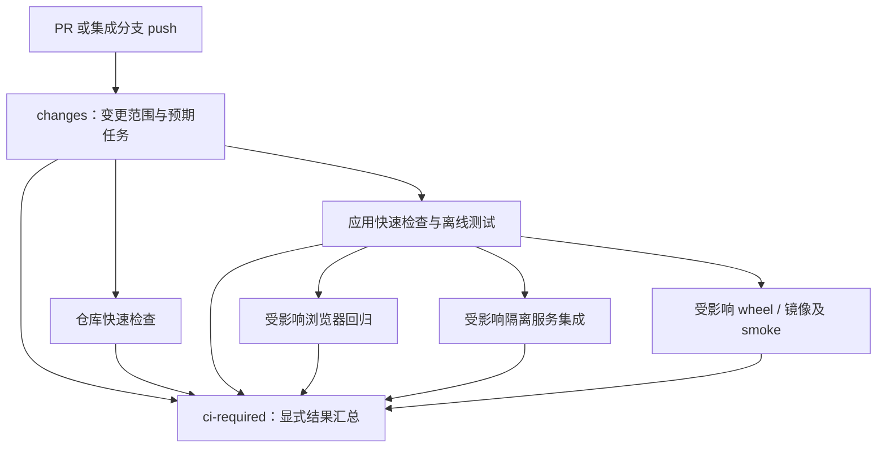

# CI 质量门禁改造方案

状态：本地实现与验证已落地，个人 fork 的真实 push 全量及统一门禁已通过，upstream PR/正式门禁迁移待验收。当前实现见 [arch.md](arch.md)，实际验证与未完成项见 [execution.md](execution.md)。未修改远端必需检查，workflow 成功不表示分支保护已启用。

编写日期：2026-10-29。目录日期暂按本次编写日期；首次提交时核对首次进入 Git 的日期，之后保持目录名稳定。

## 1. 目标与范围

建立一套能回答以下问题的 CI：本次改动影响什么、实际执行了什么检查、结果是否足以合入、待发布产物是否经过验证。

本方案属于仓库自有基础设施，放在 `docs/spec/`。本文保留改造目标和迁移任务，`arch.md` 描述已经实现的源码与测试，`execution.md` 记录验证证据。应用业务实现和测试仍归所属应用，本方案只约定检查接口、调度、结果和发布边界。

范围包括 `.github/workflows/`、必要的 `scripts/ci/` 调度辅助脚本、`scripts/tests/` 中的行为验证，以及应用已有验证入口的对接。保留应用私有依赖、锁文件和环境，不创建根 Python distribution 或根 `.venv`。

不包含自动合并、部署生产服务、业务重构、全仓统一格式化、修改分支模型或无授权的 Git 操作。发布资格校验属于本方案；实际发布和仓库设置变更在实施时按明确授权执行。

## 2. 一般项目的 CI 原则及本仓库约定

CI 没有适用于所有项目的统一 job 数量或固定工具清单。常见实践关注快速、可信、可重复的集成反馈；GitHub Actions 另有状态检查、权限和触发机制的具体约束。下表是结合这些实践作出的 Icarus 方案，不宣称通过某项行业认证。

| 原则或常见说法 | 要解决的问题 | Icarus 的具体约定 |
| --- | --- | --- |
| 持续集成、保持主线可用 | 合并后才发现集成错误 | PR 检查，合入 `feature`、`dev`、实际生产分支后再验证集成结果 |
| Shift left、快速失败 | 小错误等待长测试后才暴露 | 语法、格式、类型检查先反馈；便宜的应用检查通过后再运行昂贵任务 |
| 测试分层、按风险验证 | 只有编译检查，或每次都调用真实模型 | 区分离线功能/契约、隔离服务集成、浏览器、产物 smoke 和真实模型验收 |
| 单一验证入口 | 本地与 CI 的测试清单逐渐分叉 | 应用拥有测试选择规则；CI 调用应用入口，不在 YAML 重复维护测试文件名单 |
| 确定性与可复现性 | 同一源码因依赖漂移得到不同结果 | 固定工具版本，消费已有锁文件；区分可重复依赖解析与逐字节可复现构建 |
| 可信的质量门禁 | skipped、空矩阵或失败后的跳过被误判为成功 | 始终产生统一必需检查，并按预期任务集合逐项核验结果 |
| 最小权限、信任边界 | PR 代码接触发布凭据和写权限 | PR 只读、无发布 Secret；可信发布链路单独运行 |
| 构建一次、验证后晋级 | 测试通过的产物与发布产物不同 | 在发布运行内绑定 commit、镜像 digest、架构和验证记录，按 digest 晋级 |
| 可观测、可诊断 | 只有红灯，没有复现证据 | 保存检查范围、SHA、工具版本、JUnit、失败日志及必要截图 |
| 控制成本、明确责任 | 重复跑、旧任务占资源、失败无人处理 | 受影响范围调度、取消过期 PR 运行、应用负责自身失败，基建负责调度失败 |

“快速失败”不要求矩阵中一个应用失败就取消其他应用。保留独立任务的失败证据，矩阵通常使用 `fail-fast: false`；同一应用的昂贵后续步骤可在其快速检查失败后停止。

## 3. 已核对的基线

实施源码基线：`885a4318cfaec7742da9ff0986ceb09f5b79f234`，本地分支 `feat/webui`；已按授权从 `upstream/feature` 快进同步。远端有 `origin = xilele777/Icarus`、`upstream = Removel/Icarus`，不得混用它们的分支基线和检查结果。下表记录改造前缺口，当前实现见架构与执行记录。

工作区已有用户改动；本方案不修改它们。实施前重新记录 HEAD、目标 remote、工作区状态和现有失败 nodeid。分支保护、Ruleset、Environment 保护及实际生产分支名称须在目标仓库核验，不能从 YAML 推断为已启用。

| 当前入口 | 已有能力 | 主要缺口 |
| --- | --- | --- |
| [apps.yml](../../../.github/workflows/apps.yml) | Mem0/OpenKB 离线契约、根控制层测试、日志 | 根配置/启动器/infra 的触发遗漏；两个服务固定一起执行 |
| [backend-contracts.yml](../../../.github/workflows/backend-contracts.yml) | Agent/Gateway 双平台部分回归，Linux Agent 全套和 mypy | YAML 重复列测试文件；未接 wheel 验证；缺少取消旧运行的配置 |
| [webui.yml](../../../.github/workflows/webui.yml) | 浏览器回归、lint/format/typecheck/build、JUnit | 快速检查排在浏览器测试之后；缺少取消旧运行的配置 |
| [lint.yml](../../../.github/workflows/lint.yml) | actionlint、Python 编译、部分 Shell 语法检查 | `bash -n a.sh b.sh` 只检查首个文件；干净 checkout 上的 `git diff --check` 未检查提交差异；编译清单漏 rela-mem |
| [images.yml](../../../.github/workflows/images.yml) | 四个应用的 amd64 镜像构建、缓存 | 任一应用变化都会构建全部；没有启动 smoke |
| [publish-images.yml](../../../.github/workflows/publish-images.yml) | amd64/arm64 构建与 manifest 发布 | 未核验同一待发布 SHA 的测试资格；预发布也覆盖 `latest`；并发按 ref 分组无法保护共享标签 |
| [根测试入口](../../../scripts/test.sh) | 聚合根控制层、Mem0/OpenKB、Agent/Gateway/TUI | 未覆盖 rela-mem 和 WebUI，不能称为全仓完整验证 |

补充事实：

- 最新基线的 TUI 有完整布局/交互测试，旧 SVG 快照已移除；rela-mem 有离线与 `integration` 标记测试，改造前 CI 均未运行其测试。
- Agent 已有 `make check-package-agent`；其验证环境使用 `--system-site-packages`，接入后仍须说明隔离程度，不能称为完全干净的依赖安装验证。
- OpenKB 开发环境消费 `uv.lock`，Docker 构建尚未消费；Mem0 的现有 pip 安装尚未消费 `poetry.lock`。两者不能笼统宣称全部构建已锁定。
- 2026-10-29 的一次[上游 WebUI 运行](https://github.com/Removel/Icarus/actions/runs/40797794925)中，测试耗时 13 分 18 秒，随后静态检查加构建耗时 26 秒。这是单次样本，不是 P95 或长期基线。

## 4. 目标检查模型

### 4.1 检查层次与默认范围

| 层次 | 内容 | 默认策略 |
| --- | --- | --- |
| 快速检查 | actionlint、逐个 Shell 语法检查、Python 编译、提交差异空白检查、已有应用 lint/typecheck | 所有运行都有仓库级快速检查，应用检查按影响范围执行 |
| 离线功能与契约 | 根控制层、Agent、Gateway、TUI、rela-mem；Mem0/OpenKB 既有离线契约 | 受影响应用的 PR 必过；不得依赖真实模型 Secret |
| 浏览器回归 | WebUI 当前默认套件，使用确定性本地夹具 | WebUI 或其公共契约受影响时执行；保留现有覆盖，不先削减测试来提速 |
| 隔离服务集成 | PostgreSQL/pgvector、FalkorDB 及真实本地服务连接 | 先用于受影响 rela-mem/infra PR；服务容器、网络和临时数据随 job 生命周期创建和清理 |
| 产物验证 | Agent wheel 安装/资源/发现；受影响镜像构建与健康 smoke | 对应源码、依赖、资源或构建配置变化时执行；发布前对全部待发布产物执行 |
| 扩展回归 | Mem0/OpenKB retained 全套、扩大平台/版本组合 | 定时和手动执行；按实际失败报告，不替代 PR 门禁 |
| 真实模型验收 | 真实供应商 API、小量推理及工具流 | 手动 opt-in，明确执行与费用授权，隔离数据；默认 PR 和定时任务不调用 |

暂不引入全仓统一的 Python formatter/linter、任意覆盖率百分比或所有 OS × 所有 Python 版本的笛卡尔积。先保留 Python 3.12 的主要验证及现有 Windows 后端覆盖；后续依据应用声明的最低版本分别补兼容性验证。Agent/TUI 与 rela-mem 的最低版本不同，不强行统一。

### 4.2 Workflow 组织

目标采用一个 `.github/workflows/ci.yml` 负责事件、变更检测、任务调度和结果汇总。现有应用 workflow 逐步改为 `workflow_call` 的执行单元，保留其应用责任；仅在复用有实际收益时抽 reusable workflow，不引入通用 CI 框架。



图中只表达逻辑阶段，应用任务独立并行；不要求无关应用互相等待。汇总 job 使用 `needs` 和 `if: always()`，即使上游失败或取消也尝试报告结果。

`ci-required` 的通过条件：

1. 变更检测与仓库快速检查必须为 `success`。
2. 变更检测产生的每个预期任务必须实际执行并为 `success`；`failure`、`cancelled`、预期任务的 `skipped`、任务缺失都不能通过。
3. 只有检测结果明确判定不适用的任务允许跳过，并在摘要中列出原因。纯文档改动仍报告快速检查和无需应用测试的结论。
4. 动态矩阵在所需任务集合非空时才能启动；预期非空却生成空矩阵属于调度错误。矩阵父任务成功的前提是所有子任务正常完成，不使用 `continue-on-error` 隐藏失败。
5. 不依赖默认的“下游被跳过”行为代表失败，也不以打印 `needs` 后无条件退出 0 作为门禁实现。

目标仓库的必需检查使用稳定且唯一的 `ci-required` 名称，并核验结果来源为预期 GitHub App。该入口不使用 workflow 级 `paths` 过滤。维护人应要求分支在合并前与基线同步，或在启用 merge queue 后增加 `merge_group` 触发；本轮不默认启用队列。

### 4.3 事件、版本与并发

| 事件 | 调度范围 | 结果要求 |
| --- | --- | --- |
| PR → `feature`、`dev`、实际生产分支 | 相对 PR base 的受影响任务 | 对 GitHub 当前测试合并提交执行检查；摘要同时记录 base/head/test SHA |
| push → 上述集成/发布分支 | 相对 push before/after 的受影响任务 | 检查 push 后精确 SHA，避免只验证 PR head 而漏掉合并结果 |
| 手动 CI | 明确 ref，默认全量必需检查 | 记录解析出的精确 SHA 和选择的模式 |
| 定时扩展回归 | 目标仓库 `feature` 的精确 SHA | schedule 文件需位于 GitHub 默认分支；不假设默认分支就是 `feature` |
| release / 手动发布 | 全部待发布应用及平台，不按代码路径省略 | 重新运行同一 SHA 的完整必需检查和发布产物验证，再晋级标签 |

取消应用分支上重复的 push 自动检查，保留手动入口；PR 与集成分支 push 均保留，因为两者验证的合并状态可能不同。PR 更新时按 workflow + PR 编号取消过期运行，其他 CI 按 workflow + ref 分组，避免跨 workflow 相互取消。

变更检测获取足够的 Git 历史，PR 用 base/head 的 merge-base 计算变更，执行测试仍使用测试合并提交。push 使用 before/after；新分支、全零 before、无法取得比较基线时运行全量，或明确失败，不能返回空任务集。发布必须重新全量验证，不依赖 PR 合并 SHA 与发布 SHA 碰巧相同。

### 4.4 变更影响规则

规则由轻量、stdlib-only 的 `scripts/ci/changes.py` 维护，读取 Git 变更清单，输出简单布尔值、镜像应用数组和预期任务集合。它服务 CI 调度，不进入应用运行时，也不把 `icarus.toml` 的生产服务依赖直接当作测试依赖。

| 变更输入 | 至少执行的任务 |
| --- | --- |
| 任意变更 | 变更检测、仓库快速检查、`ci-required` |
| `icarus.toml`、`icarus.local.toml.example`、`bin/**`、`scripts/**`、`Makefile`、`.gitattributes`、`.gitignore`、`.editorconfig`、根环境示例 | 根控制层；涉及公共安装/启动/环境约定时运行所有相关应用入口回归，初期可保守全选 |
| `infra/**` | 根控制层、对应 Compose 配置校验、消费该服务的隔离集成；PostgreSQL 需同时考虑 Mem0 和 rela-mem |
| `packages/**` | Gateway、TUI 及 WebUI 公共契约相关回归，初期保守运行全部应用检查 |
| `.github/workflows/**`、CI 调度脚本 | actionlint、调度行为测试、全部必需任务及镜像检查，防止 workflow 修改自我漏测 |
| `apps/agent/**` | Agent、Gateway、Agent wheel；早期保守保留 WebUI 聊天契约回归 |
| `apps/gateway/**` | Gateway、TUI、WebUI 聊天契约回归 |
| `apps/tui/**` | TUI 全套及当前布局/交互验收 |
| `apps/webui/**` | WebUI 静态检查、默认测试、构建和镜像 smoke；不再无条件触发全部后端单测 |
| `apps/mem0/**`、`apps/openkb/**`、`apps/rela-mem/**` | 对应应用检查及镜像；保守补相应消费者的 Agent/WebUI 契约回归，rela-mem 增加隔离服务集成 |
| 应用依赖、锁文件、Dockerfile、构建资源 | 归属应用的验证和产物任务，不能只按源码后缀识别 |
| 文档、图片或其他已明确分类的无执行影响文件 | 仓库快速检查；仅对确认纯文档的目录做减法，不全局忽略 Markdown/JSON |
| 新增应用、未识别的代码/配置路径、无法解析的变更 | 保守运行全部必需任务，在摘要中提示补充映射 |

首版优先避免漏测，之后凭实际依赖和测试证据缩小范围。删除、重命名须考虑旧路径和新路径；文件名以 NUL 分隔解析，覆盖空格与非 ASCII 路径。不能只检查重命名后的路径。

### 4.5 本地与 CI 的执行契约

应用入口拥有测试选择、环境初始化和退出码；Linux CI 优先调用 `make test-*`、`make typecheck-agent`、`make check-package-agent`，WebUI 使用已有 pnpm scripts。Windows 保留原生 Python 执行，待应用提供跨平台入口后统一，不能把 Linux `.venv/bin/python` 硬搬到 Windows。

必要时为应用脚本补充参数透传和报告路径，Windows 的部分回归选择也迁回应用侧维护。Mem0/OpenKB 当前默认清单先保留；未来改用 marker 必须对照 collection nodeid 证明没有丢失现有契约，不能靠标签迁移缩小门禁。

`make test` 的聚合范围随本次接入补齐或明确命名说明。若扩展为全仓离线入口，需把 rela-mem 离线测试和 WebUI 的临时 dev server 启停一并纳入；隔离服务和真实模型验收仍使用单独入口，不让默认测试隐式连接用户服务。

日志和 JUnit 上传使用 `if: always()`；测试本身必须保留退出码，管道使用 `pipefail`。缺依赖、collection error、检查未执行、零测试异常均明确报告，不算通过。不添加自动重跑直到成功的策略；不稳定测试须登记 nodeid、原因、责任范围和处理期限。

## 5. 发布与供应链边界

普通 CI 不登录镜像仓库、不接触发布 Secret、不发布镜像；保持 `contents: read`、checkout 不持久化凭据，不以 `pull_request_target` 执行 PR 代码。Actions 优先固定经核验的完整 commit SHA 并注释版本，通过依赖更新 PR 维护；缓存按 OS、工具链和依赖输入隔离，不作为正确性的前提。

依赖可重复性分步补齐：保留 WebUI frozen lockfile、OpenKB locked sync；逐应用确定 Python 锁定方式并让测试和生产构建实际消费。记录 OS/架构差异，不把“仓库存在 lockfile”当成构建已锁定，也不为此增加根共享依赖文件。

发布方案选择在可信发布运行内重新验证精确 SHA，避免跨 workflow 拉取 PR artifact 的信任和 SHA 对应问题：

1. 校验触发仓库、版本格式、tag 对应的 commit 和允许发布的来源；手动输入版本必须绑定真实 tag/ref，不能仅给当前任意分支打上版本名。生产分支名称实施时核验。
2. 对该 SHA 全量运行必需离线检查、隔离集成及产物验证；不接受其他 SHA 或先前部分检查的绿灯作为资格。
3. 构建各架构镜像并对该构建产物 smoke。需要启动时使用 Buildx 的 `load` 或明确导出/拉取按 digest 的产物，不能假设 `push: false` 会自动加载到 Docker daemon。
4. 可信任务使用现有 `DOCKER` Environment 凭据推送候选镜像，记录各应用/架构 digest；后续直接按这些 digest 合成 manifest，不在验证后重建。
5. 正式版本更新版本标签；预发布只更新其预发布版本标签。`latest` 仅由正式版本的显式晋级步骤更新。
6. 可变标签的晋级使用跨 ref 的共同并发组，关闭运行中取消；在持有串行窗口时再次检查当前版本，较旧版本不能覆盖较新 `latest`。不要假设 concurrency 保证版本顺序或默认保存所有排队发布。
7. 输出版本 → commit → 各架构 digest → manifest digest → 验证结果的记录。重跑相同版本若 digest 不同，必须阻止覆盖或走明确的人工处置，不把版本标签当任意可改别名。

隔离服务 smoke 使用 CI 临时凭据、临时数据库/schema/graph 和 job 专属资源名，不读取开发者根 `.env` 或持久数据。WebUI smoke 提供启动所需测试鉴权；Mem0/OpenKB 使用本地夹具或禁用推理的启动模式，缺少支持时由应用提供最小适配，不偷偷调用真实模型。

依赖扫描、镜像扫描、SBOM、签名和构建来源证明列为后续增强。先建立漏洞基线、可用工具与处置规则，再决定哪些扫描阻断合并；不在此阶段宣称已满足 SLSA 等级。

## 6. 分阶段实施任务

### 阶段一：修复现有漏测和失效检查

涉及现有 workflow、应用验证脚本、`Makefile`、`scripts/test.sh` 和相关 `scripts/tests/`；这一阶段先保留现有 workflow 结构，不等待调度重构。

- [x] 补 TUI 全套/布局交互、rela-mem 离线测试、Agent wheel 检查，编译清单补 rela-mem。
- [x] 补关键根路径触发；若根测试读取某个 Compose/应用配置，其改动也应触发根测试。
- [x] Shell 脚本逐个检查；对真实 base/head 执行 `git diff --check`，保留 `.gitattributes` 对快照尾空格的例外。
- [x] WebUI 快速检查前移，为 WebUI/Backend 配置取消旧运行，保留失败报告。
- [x] 对入口透传、退出码等行为变更补 focused pytest；无业务变更不新增镜像业务逻辑。

验收：有效首脚本加无效第二脚本必须失败；已提交的新增尾空格必须被差异检查捕获；TUI/rela-mem 中引入可控失败时对应 job 失败；wheel 校验实际执行。原有测试仍完整运行，不能以移除测试解决新增红灯。

### 阶段二：统一调度和必需门禁

计划新增 `.github/workflows/ci.yml`、`scripts/ci/changes.py`、`scripts/tests/test_ci_changes.py`；结果校验优先保持简单，在需要独立测试时新增 `scripts/ci/check_results.py` 与对应测试。改造现有 workflow 为受调度执行单元，并更新 `scripts/tests/test_repository_infra.py` 的旧结构断言。

- [x] 用表驱动 pytest 验证影响规则，包括根文件、公共协议、锁文件、未知路径、删除、双向重命名和纯文档。
- [x] 实现事件的基线解析、明确 fallback 和期望任务输出，不能靠 GitHub 有限的 paths 差异列表作为完整影响分析。
- [x] 接入无 workflow 级路径过滤的 `ci-required`，测试 success/failure/cancelled/skipped/缺失结果/空矩阵。
- [x] 应用测试选择回到应用入口。
- [ ] 取消应用分支重复 push 触发，保留 PR、集成分支 push 和手动运行；须先取得下一项的新旧对照证据。
- [ ] 并行观察新旧检查，只有新调度得到实际运行证据后才移除旧触发器；过渡重复只临时存在。
- [ ] 最后在明确目标 remote 上切换必需检查，核验它确实阻止失败 PR 合入；这项仓库设置操作需相应授权。

验收：任何预期任务失败/取消/漏跑都不能产生可合并绿灯；纯文档 PR 正常完成而非永久 Pending；更新 PR 后旧运行取消，新运行完整执行；合并进入 `feature` 后产生新的 push 验证。

### 阶段三：隔离集成、产物与发布资格

涉及服务应用的 app-owned 测试夹具/入口、`images.yml`、`publish-images.yml` 和必要调度接口；应用实现细节由对应应用计划维护。

- [x] rela-mem 在 CI 创建独立 PostgreSQL/FalkorDB，运行全部标记集成测试，失败也清理本次资源；本地已实际验证。
- [x] 为四个应用建立最小镜像 smoke；Agent wheel 增加不依赖源码目录和 editable install 的验证，登记纯净依赖环境验证结果。
- [x] 实现发布复用验证单元，对精确 SHA 全量执行；按架构记录 digest 并按 digest 晋级。
- [x] 为 tag/ref 不匹配、预发布更新 `latest`、旧版本覆盖新版本、相同版本 digest 冲突建立无发布凭据的策略测试。
- [x] 以模拟 registry 的无凭据测试核验 dry-run 发布决策和 manifest 输入，确保不写标签。
- [ ] 实际验证 ARM 产物及完整可信发布链；手动 dry-run 只禁止最终标签更新，仍会推候选，未实际执行，不能视为无写入演练。

验收：能构建但不能启动的镜像必须失败；服务集成失败阻止门禁；未验证 SHA、预发布或过期版本不能越过对应发布规则；记录可追溯到实际 smoke 的同一 digest。

### 阶段四：依赖稳定性与持续维护

- [x] Actions 固定完整 SHA，并增加 Dependabot 更新策略。
- [ ] 逐应用推进依赖锁消费，不一次重写全部依赖体系。
- [x] 增加定时/手动扩展回归入口；先记录 retained 全套的失败集合和缺失环境，不将已有失败伪装为通过。
- [ ] 在远端补齐并实际运行 retained 全套环境；schedule 还要求 workflow 进入默认分支。
- [ ] 增加耗时统计和必要分片；浏览器分片必须保证 nodeid 集合无丢失、无意外重叠，再比较收益。
- [ ] 引入有处置责任的依赖/镜像扫描；按需要再推进 SBOM、签名、来源证明。

验收：缓存关闭时仍能正确运行；扩展回归保留真实退出码；测试漂移、依赖缺失和基础设施失败有明确报告及处理归属。

## 7. 验证、度量与迁移回退

实施按仓库顺序执行：最小受影响测试 → 对应应用套件 → 编译、actionlint 和差异检查。应用入口扩展后复用如下命令；不把示例命令已存在视为已执行。

```bash
apps/agent/.venv/bin/python -m pytest scripts/tests -q
make test-agent
make typecheck-agent
make check-package-agent
make test-gateway
make test-tui
make test-mem0
make test-openkb
make test-rela-mem
make test-rela-mem-integration
```

WebUI 在自身目录执行已有 `pnpm lint`、`pnpm format:check`、`pnpm typecheck`、`pnpm build`；默认测试由应用入口启动临时 dev server、执行 `pnpm test`，并在退出时清理服务。隔离集成命令只在临时服务就绪后执行，Windows 使用应用实际支持的原生命令。

目标运行证据至少包括：仓库、事件、base/head/test SHA、规则选择及跳过原因、预期/实际任务、环境工具版本、失败 nodeid 和产物身份。现有选择/汇总摘要、Actions 日志、JUnit 和发布记录分担这些内容。测试报告默认保存 14 天，发布身份记录目前上传 90 天；随 release 长期归档仍待实现。上传前确保不包含 Secret 或真实用户资料。

以至少 20 次有代表性的运行建立耗时基线，区分冷/热缓存和排队时间。初始优化目标为快速检查 P95 不超过 5 分钟、普通离线反馈不超过 10 分钟、WebUI 默认回归不超过 20 分钟；这是待验证的目标，不是当前能力承诺。镜像单列耗时，不通过削减契约覆盖迎合目标。

调度正确性优先指标：关键路径映射无已知遗漏、预期任务执行率 100%、漏跑不会报成功、正式发布产物身份可追溯。同步统计重复运行和 flaky nodeid；运行耗时变短不能抵消覆盖下降。

迁移时保持旧必需检查直到新检查已完成真实 PR、失败注入和集成分支验证。失败时按逻辑变更恢复旧 workflow 触发和原必需检查；若影响检测不可靠，临时全量运行，不能关闭检查。回退只作用于 CI 配置，不回滚用户数据库、不删除服务数据、不以强推改历史。

本次交付包含 workflow、调度/策略脚本、应用验证入口、镜像 smoke 夹具及上述文档。已执行隔离本地服务与浏览器验证，未调用真实模型；随后获准提交/推送至个人 fork 试运行，不包含合并、真实发布或修改远端设置。勾选表示本地实现及对应证据完成，远端迁移和长期治理任务继续保持未勾选；具体通过、失败与未验证范围以执行记录为准。

## 8. 参考依据

以下资料用于区分通用实践、GitHub 平台约束和本仓库决策；链接于 2026-10-29 核对。

- [Martin Fowler：Continuous Integration](https://martinfowler.com/articles/continuousIntegration.html)：自动构建与测试、快速反馈、集成后验证和维护主线。
- [GitHub：Troubleshooting required status checks](https://docs.github.com/en/pull-requests/collaborating-with-pull-requests/collaborating-on-repositories-with-code-quality-features/troubleshooting-required-status-checks)：SHA 对应、workflow 跳过导致 Pending、job 跳过及下游失败后的门禁行为。
- [GitHub：Control workflow concurrency](https://docs.github.com/en/actions/how-tos/write-workflows/choose-when-workflows-run/control-workflow-concurrency)：并发组、取消旧运行、等待任务与顺序限制。
- [GitHub：Secure use reference](https://docs.github.com/en/actions/reference/security/secure-use)：最小信任边界、PR/高权限事件风险、固定 Actions 依赖及更新。
- [仓库贡献指南](../../../CONTRIBUTING.md)与 [AGENTS.md](../../../AGENTS.md)：应用所有权、环境、验证顺序、文档落点与授权边界。
